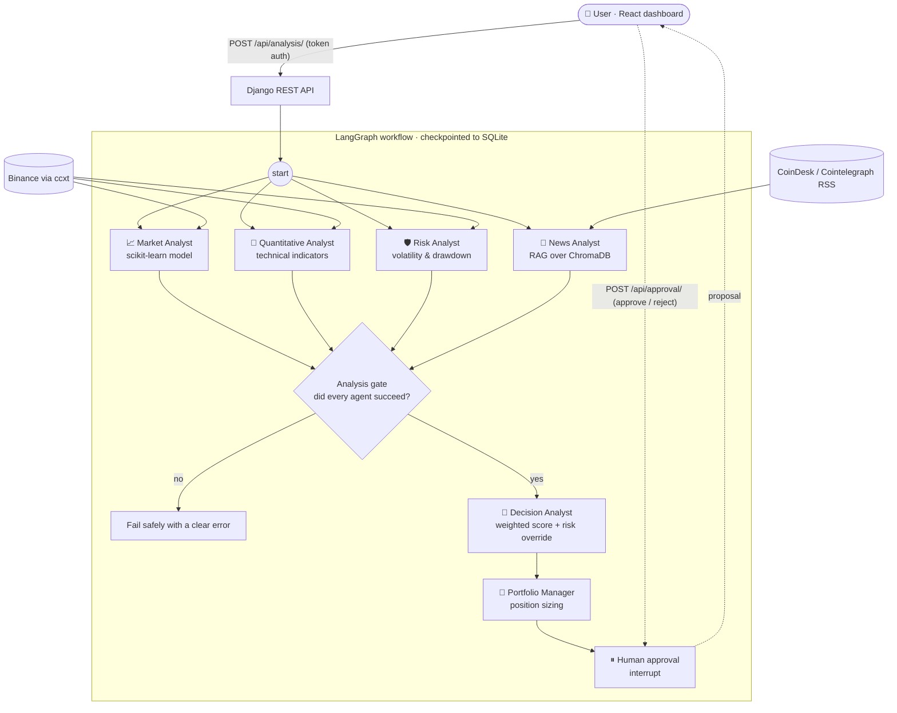

<div align="center">

# 🧠 QuantMind

### A multi-agent AI system for crypto market analysis, with a human in the loop

Four specialised agents analyse a market in parallel. Their signals are merged into one risk-checked decision, and **nothing is final until a human approves it.**

[](https://www.python.org/)
[](https://langchain-ai.github.io/langgraph/)
[](https://www.django-rest-framework.org/)
[](https://react.dev/)
[](https://scikit-learn.org/)
[](https://www.trychroma.com/)
[](https://www.docker.com/)

**[Live demo](https://radiantvixen.github.io/QuantMind/)** · [Architecture](#-architecture) · [Tech stack](#-tech-stack) · [Engineering highlights](#-engineering-highlights) · [Run it locally](#-run-it-locally)

</div>

<!-- Add a screenshot of the dashboard here, e.g.:
<p align="center"></p>
-->

---

## 📌 Overview

Trading decisions usually mix very different kinds of evidence: what a model predicts, what the chart shows, how risky the market is, and what the news says. Most tools show these separately and leave you to combine them in your head.

**QuantMind combines them automatically and explains its reasoning.**

You pick a market (for example `BTC/USDT`) and describe your portfolio. Four agents then run **at the same time**:

| | Agent | Question it answers |
|---|---|---|
| 📈 | **Market Analyst** | Where does a machine-learning model expect the price to go? |
| 🔢 | **Quantitative Analyst** | What do the technical indicators say (trend, RSI, momentum, support and resistance)? |
| 🛡️ | **Risk Analyst** | How volatile is this market, and how deep can it fall? |
| 📰 | **News Analyst** | Is today's crypto news bullish or bearish? *(retrieval-augmented, from live RSS feeds)* |

A **Decision Analyst** merges their signals into **BUY**, **HOLD**, or **AVOID**. A **Portfolio Manager** sizes the position to fit your risk budget. Then the workflow **pauses and waits for you to approve or reject** the proposal on the dashboard.

> ⚠️ QuantMind is an educational and portfolio project. It doesn't place real trades and is not financial advice.

---

## ✨ Key features

- **Parallel multi-agent workflow:** four analysts run at once in a LangGraph state graph, and their results meet at a single checkpoint.
- **Human-in-the-loop approval:** the graph pauses mid-run, saves its state, and resumes only when the user decides, even if that's minutes later in a separate HTTP request.
- **Retrieval-augmented news analysis:** articles are embedded with sentence-transformers, stored in ChromaDB, and searched by meaning to find what's relevant to the chosen asset.
- **Machine-learning forecast:** a scikit-learn model trained on engineered features from historical candles, with evaluation and backtesting modules.
- **Risk-first decisions:** a high-risk market always forces HOLD, however strong the other signals are.
- **Position sizing:** risk-per-trade and stop-loss sizing, capped by a maximum portfolio exposure.
- **Explainable output:** every decision comes with its score, how much the analysts agreed, and a plain-text breakdown.
- **Secure multi-user API:** token authentication, password validation, rate-limited login, and approvals restricted to the user who started the analysis.
- **AI-assistant integration:** an MCP server exposes the prediction, risk, and news tools to AI assistants such as Claude.
- **Interactive dashboard:** a React dashboard with live price charts, pipeline status, and analyst panels.
- **Containerised and automated:** Docker Compose runs the full stack, and GitHub Actions deploys the frontend to GitHub Pages.

---

## 🏗 Architecture



**Request lifecycle**

1. The dashboard sends the market and portfolio settings to the Django API with the user's auth token.
2. The API starts a LangGraph run with a unique `thread_id` and records which user owns it.
3. The four analysts **fan out** in parallel, then **fan in** at the analysis gate.
4. The decision and sizing nodes produce a proposal, and the graph **pauses** at the approval node. Its state is saved to SQLite.
5. The user reviews the proposal and approves or rejects it. The API checks ownership and **resumes the same thread** from its checkpoint to finish the run.

---

## 🛠 Tech stack

| Area | Technologies | Why |
|---|---|---|
| **Agent orchestration** | LangGraph, SQLite checkpointer | It models the workflow as an explicit graph with parallel branches, conditional routing, and built-in pause/resume for human approval. |
| **Machine learning** | scikit-learn, pandas, joblib | A standardised logistic-regression pipeline with balanced classes. It's fast, easy to interpret, and a strong baseline for price direction. |
| **Feature engineering** | pandas | Returns, moving-average ratios, rolling volatility, volume change, and RSI. |
| **RAG and NLP** | sentence-transformers (`all-MiniLM-L6-v2`), ChromaDB, feedparser | Search by meaning finds relevant articles even when the wording differs from the query, and everything runs locally without paid APIs. |
| **Market data** | ccxt (Binance) | One unified exchange API, so other exchanges can be added later. |
| **Backend API** | Django, Django REST Framework, django-cors-headers | Mature authentication, validation, admin panel, and ORM. |
| **Authentication** | DRF token auth, Django password validators, throttling | Token headers work across domains: the frontend is on GitHub Pages, and the API is hosted separately. |
| **Frontend** | React 19, Vite, Recharts | A fast, component-based dashboard with interactive charts. |
| **AI integration** | Model Context Protocol (MCP) | Lets AI assistants call QuantMind's tools directly. |
| **DevOps** | Docker, Docker Compose, Nginx, GitHub Actions, GitHub Pages | One command runs the whole stack locally, and the frontend deploys automatically on push. |

---

## 💡 Engineering highlights

These are the design decisions I'm most interested in discussing:

**1. Fan-out and fan-in with fault isolation.**
Each analyst is wrapped in a "safe" node that catches its own errors and records them in the shared state instead of crashing the graph. A gate node then waits for all four analysts and routes conditionally: it continues only if the essential signals are present, and otherwise it ends with a clear error message.

**2. Human approval that survives across HTTP requests.**
LangGraph's `interrupt()` pauses the graph at the approval node, and the SQLite checkpointer persists its state under a `thread_id`. A later `/api/approval/` request resumes the *same* run with `Command(resume=...)`, so no work is repeated and the decision can't change between review and approval.

**3. Risk as a hard constraint, not just another signal.**
The decision score is a weighted blend (50% ML, 20% trend, 15% RSI, 15% news), but a HIGH risk level overrides the blend and forces HOLD. Position sizing is bounded both by the risk budget and by the remaining room under the exposure limit.

**4. Authorisation, not just authentication.**
Every analysis is stored as an `AnalysisRun` linked to its owner. The approval endpoint returns **404** for another user's thread, so it doesn't even reveal that the thread exists, and **409** if the analysis was already reviewed. This prevents both cross-user tampering and double approvals.

**5. Built for split hosting.**
The frontend reads its API URL at build time and uses header-based tokens rather than cookies. That lets it run as a static site on GitHub Pages while the Python backend runs anywhere that supports Docker.

**6. Tested where it matters.**
The API tests cover registration, login, logout, unauthenticated access, and approval ownership. The agent graph is mocked in these tests, so they're fast and don't call external services.

---

## 🚀 Run it locally

**With Docker (one command):**

```bash
git clone https://github.com/RadiantVixen/QuantMind.git
cd QuantMind
docker compose up --build
```

Open **http://localhost:3000**, create an account, and run your first analysis.

<details>
<summary><b>Without Docker</b></summary>

Requires Python 3.11+ and Node.js 22+.

```bash
# Backend
python -m venv .venv && source .venv/bin/activate
pip install -r backend/requirements.txt
cd backend
python manage.py migrate
python manage.py runserver            # http://127.0.0.1:8000
```

```bash
# Frontend (second terminal)
cd frontend
npm install
npm run dev                           # http://localhost:5173
```

```bash
# Tests
cd backend && python manage.py test api

# One analysis from the command line, no UI
python run_quantmind.py
```

The first run downloads the embedding model, so it takes a little longer.

</details>

---

## 📁 Project structure

```
QuantMind/
├── intelligence/            # The AI core
│   ├── agents/
│   │   ├── graph.py         # LangGraph workflow (parallel agents → gate → decision → approval)
│   │   ├── state.py         # shared typed state
│   │   ├── nodes/           # one module per agent
│   │   └── rag/             # news ingestion, embeddings, vector store, sentiment
│   ├── data/                # market data ingestion (Binance via ccxt)
│   ├── features/            # technical indicators and feature pipeline
│   ├── ml/                  # dataset, training, evaluation, backtesting
│   └── mcp/                 # MCP server for AI assistants
├── backend/                 # Django REST API (auth, analysis, approval, market data)
├── frontend/                # React + Vite dashboard
├── docker-compose.yml
└── .github/workflows/       # automatic GitHub Pages deployment
```

---

## 📚 Reference

<details>
<summary><b>API endpoints</b></summary>

Every endpoint except register and login needs the header `Authorization: Token <token>`.

| Method | Endpoint | Description |
|---|---|---|
| `POST` | `/api/auth/register/` | Create an account → `{ token, user }` |
| `POST` | `/api/auth/login/` | Sign in → `{ token, user }` |
| `POST` | `/api/auth/logout/` | Invalidate the token |
| `GET` | `/api/auth/me/` | Current user |
| `POST` | `/api/analysis/` | Run the agent workflow. Returns the analysis and a `thread_id` |
| `POST` | `/api/approval/` | `{ thread_id, approved }` resumes the paused run |
| `GET` | `/api/market-data/?symbol=BTC/USDT&timeframe=1h` | Last 100 candles for the chart |

Example analysis request (every field is optional):

```json
{
  "symbol": "BTC/USDT",
  "timeframe": "1h",
  "portfolio_value": 10000,
  "risk_per_trade_pct": 1.0,
  "stop_loss_pct": 2.0,
  "max_exposure_pct": 20.0,
  "current_exposure_pct": 0.0
}
```

</details>

<details>
<summary><b>Decision and sizing formulas</b></summary>

```
score = 0.50 × ML signal      (2 × probability_up − 1)
      + 0.20 × trend signal   (bullish +1 / neutral 0 / bearish −1)
      + 0.15 × RSI signal     (≥55 → +1, ≤45 → −1, else 0)
      + 0.15 × news signal    (bullish +1 / neutral 0 / bearish −1)

risk_level == HIGH → HOLD        (risk always overrides)
score ≥ +0.25      → BUY
score ≤ −0.25      → AVOID
otherwise          → HOLD

risk_budget    = portfolio_value × risk_per_trade_pct
position_value = risk_budget ÷ stop_loss_pct, capped by remaining exposure room
```

</details>

<details>
<summary><b>MCP server</b></summary>

`intelligence/mcp/server.py` exposes three tools to AI assistants: `get_market_prediction`, `get_risk_assessment`, and `search_crypto_news`.

```bash
python -m intelligence.mcp.server
```

</details>

<details>
<summary><b>Deployment</b></summary>

**Frontend (GitHub Pages):** deployed automatically by `.github/workflows/deploy-frontend.yml` on every push to `main` that changes `frontend/`. To enable it, set Settings → Pages → Source to **GitHub Actions**, then add a repository variable `VITE_API_URL` with the backend's public URL.

**Backend:** any Docker host works (Render, Railway, Fly.io, or a VPS). Build `backend/Dockerfile` from the repository root, and set these variables:

| Variable | Purpose |
|---|---|
| `DJANGO_SECRET_KEY` | Long random secret, required in production |
| `DJANGO_DEBUG` | `false` in production |
| `CORS_ALLOWED_ORIGINS` | e.g. `https://radiantvixen.github.io` |

Serve the backend over HTTPS.

</details>

---

## 🗺 Roadmap

- [ ] Host the backend publicly so the live demo runs end to end
- [ ] Analysis history page for each user (the data is already stored in `AnalysisRun`)
- [ ] Backtesting results and model metrics on the dashboard
- [ ] LLM-written explanations alongside the rule-based breakdown
- [ ] Run the backend test suite in CI on every pull request

---

<div align="center">

Built by **[RadiantVixen](https://github.com/RadiantVixen)**.
If you're a recruiter or an engineer and want to talk about this project, feel free to reach out through my GitHub profile.

</div>
