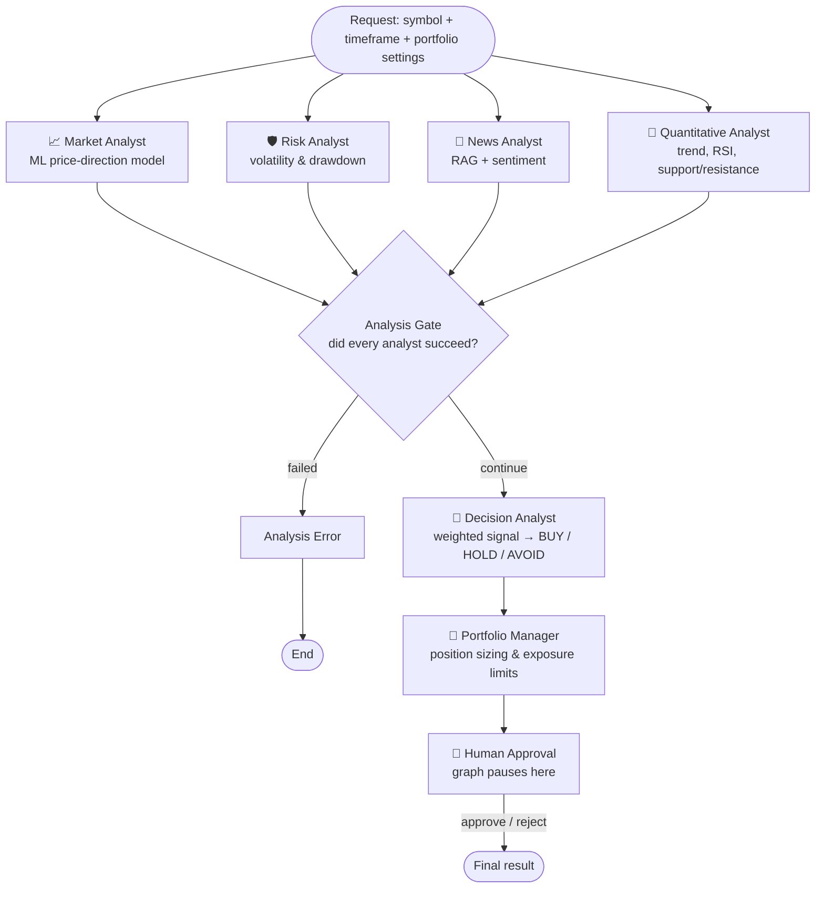

# QuantMind

**A multi-agent crypto market analysis system with a human in the loop.**

QuantMind looks at a crypto market (for example `BTC/USDT`) from four angles at once: a machine-learning forecast, technical indicators, risk metrics, and live news sentiment. It combines them into one decision (**BUY**, **HOLD**, or **AVOID**), sizes a position for your portfolio, and then **waits for a human to approve or reject** the proposal before anything is final.

It's built with **LangGraph** (agent orchestration), **Django REST Framework** (API), and **React + Vite** (dashboard).

🔗 **Live frontend:** https://radiantvixen.github.io/QuantMind/
_(needs a running backend to produce analyses; see [Deployment](#deployment))_

> ⚠️ **Disclaimer:** QuantMind is an educational project. It is **not financial advice** and doesn't place real trades.

---

## Table of contents

- [How it works](#how-it-works)
- [The agents](#the-agents)
- [Tech stack](#tech-stack)
- [Project structure](#project-structure)
- [Getting started](#getting-started)
- [API reference](#api-reference)
- [MCP server](#mcp-server)
- [Deployment](#deployment)

---

## How it works

Each analysis runs as a **LangGraph state graph**. Four analyst agents run **in parallel**. A gate checks that they all succeeded, then a decision agent merges their signals and a portfolio manager sizes the trade. Finally, the graph **pauses** at an approval step until a human responds.



Because the graph is **checkpointed to SQLite**, a paused analysis survives between requests. The API gives back a `thread_id`, and a later call to `/api/approval/` resumes that exact run.

### What happens during one analysis

1. **Market data:** OHLCV candles are fetched from Binance through `ccxt`.
2. **Features:** returns, moving averages, volatility, and volume changes are computed.
3. **Parallel analysis:** the four analysts each add their findings to a shared state.
4. **Decision:** signals are merged with fixed weights (see below). A high-risk market always forces a HOLD.
5. **Sizing:** the portfolio manager turns the decision into a position size that respects your risk budget.
6. **Approval:** the dashboard shows the proposal. You approve or reject it, and the graph finishes.

---

## The agents

| Agent | What it does | Output |
|---|---|---|
| **Market Analyst** | Runs a scikit-learn **logistic regression** model (`intelligence/ml/model.joblib`) on engineered features to predict the next move. | `prediction`, `probability_up`, `probability_down`, `latest_price` |
| **Risk Analyst** | Measures annualized volatility and maximum drawdown, then classifies the market's risk. | `risk_level` (LOW / MEDIUM / HIGH), metrics |
| **News Analyst** | Pulls RSS news (CoinDesk, Cointelegraph), embeds articles with `all-MiniLM-L6-v2`, stores them in **ChromaDB**, retrieves the most relevant ones, and scores their sentiment. | `news_sentiment`, `news_sentiment_score`, articles |
| **Quantitative Analyst** | Classic technical analysis: trend, RSI, momentum, volatility regime, support and resistance. | `quant_trend`, `quant_rsi`, `quant_support`, … |
| **Analysis Gate** | Each analyst is wrapped in a "safe" node that catches errors. The gate stops the run cleanly if any analyst failed. | `analysis_status` |
| **Decision Analyst** | Merges the signals into one score in [-1, +1]. | `decision`, `decision_score`, `analyst_agreement`, `explanation` |
| **Portfolio Manager** | Sizes the position from risk per trade and stop-loss distance, capped by maximum portfolio exposure. | `recommended_position_value`, `estimated_max_loss`, … |
| **Approval** | Pauses the graph with a LangGraph `interrupt()` until a human answers. | `approval_status` (APPROVED / REJECTED) |

### Decision formula

```
score = 0.50 × ML signal      (2 × probability_up − 1)
      + 0.20 × trend signal   (bullish +1 / neutral 0 / bearish −1)
      + 0.15 × RSI signal     (≥55 → +1, ≤45 → −1, else 0)
      + 0.15 × news signal    (bullish +1 / neutral 0 / bearish −1)

risk_level == HIGH → HOLD   (risk always overrides)
score ≥ +0.25      → BUY
score ≤ −0.25      → AVOID
otherwise          → HOLD
```

### Position sizing

```
risk_budget    = portfolio_value × risk_per_trade_pct
position_value = risk_budget ÷ stop_loss_pct
               → capped by the remaining room under max_exposure_pct
```

---

## Tech stack

| Layer | Technologies |
|---|---|
| Agent orchestration | LangGraph, LangGraph SQLite checkpointer |
| Machine learning | scikit-learn, pandas, joblib |
| Market data | ccxt (Binance) |
| News RAG | feedparser, sentence-transformers, ChromaDB |
| API | Django, Django REST Framework, django-cors-headers |
| Frontend | React 19, Vite, Recharts |
| Tooling | Docker, Docker Compose, Nginx, GitHub Actions, MCP |

---

## Project structure

```
QuantMind/
├── backend/                  # Django REST API
│   ├── api/                  # views, serializers, services (runs the graph)
│   ├── config/               # Django settings and URLs
│   └── Dockerfile
├── frontend/                 # React + Vite dashboard
│   ├── src/
│   │   ├── components/       # AnalysisForm, AnalystPanels, DecisionCard,
│   │   │                     # PriceChart, ApprovalPanel
│   │   ├── api.js            # API client
│   │   └── App.jsx
│   ├── nginx.conf            # serves the build and proxies /api in Docker
│   └── Dockerfile
├── intelligence/             # The "brain"
│   ├── agents/
│   │   ├── graph.py          # LangGraph workflow definition
│   │   ├── state.py          # shared state schema
│   │   ├── nodes/            # one file per agent
│   │   └── rag/              # news ingestion, embeddings, vector store, sentiment
│   ├── data/                 # market data ingestion (Binance provider)
│   ├── features/             # technical indicators and feature pipeline
│   ├── ml/                   # dataset, training, evaluation, backtesting, model
│   └── mcp/                  # MCP server that exposes tools to AI assistants
├── run_quantmind.py          # run one analysis from the command line
├── stream_quantmind.py       # stream graph steps from the command line
├── human_approval.py         # CLI demo of the approval flow
├── docker-compose.yml
└── .github/workflows/        # GitHub Pages deployment
```

---

## Getting started

### Option 1: Docker (recommended)

```bash
git clone https://github.com/RadiantVixen/QuantMind.git
cd QuantMind
docker compose up --build
```

- Dashboard: http://localhost:3000
- API: http://localhost:8000/api/

### Option 2: Run locally

**Requirements:** Python 3.11+, Node.js 22+

**1. Backend**

```bash
python -m venv .venv
source .venv/bin/activate            # Windows: .venv\Scripts\activate
pip install -r backend/requirements.txt

cd backend
python manage.py migrate
python manage.py runserver           # http://127.0.0.1:8000
```

**2. Frontend** (in a second terminal)

```bash
cd frontend
npm install
npm run dev                          # http://localhost:5173
```

The Vite dev server forwards `/api` to `http://127.0.0.1:8000`. To use a different backend, set `API_URL`.

**3. Command line only (no UI)**

```bash
python run_quantmind.py
```

> The first run downloads the sentence-transformers embedding model, so it takes a little longer.

---

## API reference

Base URL: `/api`

### `POST /api/analysis/`

Starts a new analysis. Every field is optional.

```json
{
  "symbol": "BTC/USDT",
  "timeframe": "1h",
  "portfolio_value": 10000,
  "risk_per_trade_pct": 1.0,
  "stop_loss_pct": 2.0,
  "max_exposure_pct": 20.0,
  "current_exposure_pct": 0.0
}
```

`timeframe` must be one of `15m`, `1h`, `4h`, `1d`.

The response contains all the analyst outputs, the decision, position sizing, a `thread_id`, and `"approval_required": true`.

### `POST /api/approval/`

Resumes a paused analysis with the human's decision.

```json
{ "thread_id": "<from the analysis response>", "approved": true }
```

### `GET /api/market-data/?symbol=BTC/USDT&timeframe=1h`

Returns the last 100 OHLCV candles for the price chart.

---

## MCP server

`intelligence/mcp/server.py` exposes QuantMind's capabilities as **Model Context Protocol** tools, so an AI assistant can call them directly:

- `get_market_prediction(symbol, timeframe)`
- `get_risk_assessment(symbol, timeframe)`
- `search_crypto_news(query, top_k)`

```bash
python -m intelligence.mcp.server
```

---

## Deployment

### Frontend → GitHub Pages

The dashboard is deployed automatically by [`.github/workflows/deploy-frontend.yml`](.github/workflows/deploy-frontend.yml) on every push to `main` that changes `frontend/`.

One-time setup:

1. On GitHub, open **Settings → Pages** and set **Source** to **GitHub Actions**.
2. In **Settings → Secrets and variables → Actions → Variables**, add `VITE_API_URL` and set it to the public URL of your backend (for example `https://quantmind-api.onrender.com`).
3. Push to `main`, or run the workflow by hand from the **Actions** tab.

### Backend

GitHub Pages only serves static files, so the Django + LangGraph backend needs its own host. Any service that runs Docker works, such as Render, Railway, Fly.io, or a VPS. Use `backend/Dockerfile` with the repository root as the build context.

Set this environment variable on the backend so the browser accepts its responses on the Pages site:

```
CORS_ALLOWED_ORIGINS=https://radiantvixen.github.io
```

---

## License

No license has been chosen yet. Until one is added, all rights are reserved by the author.
